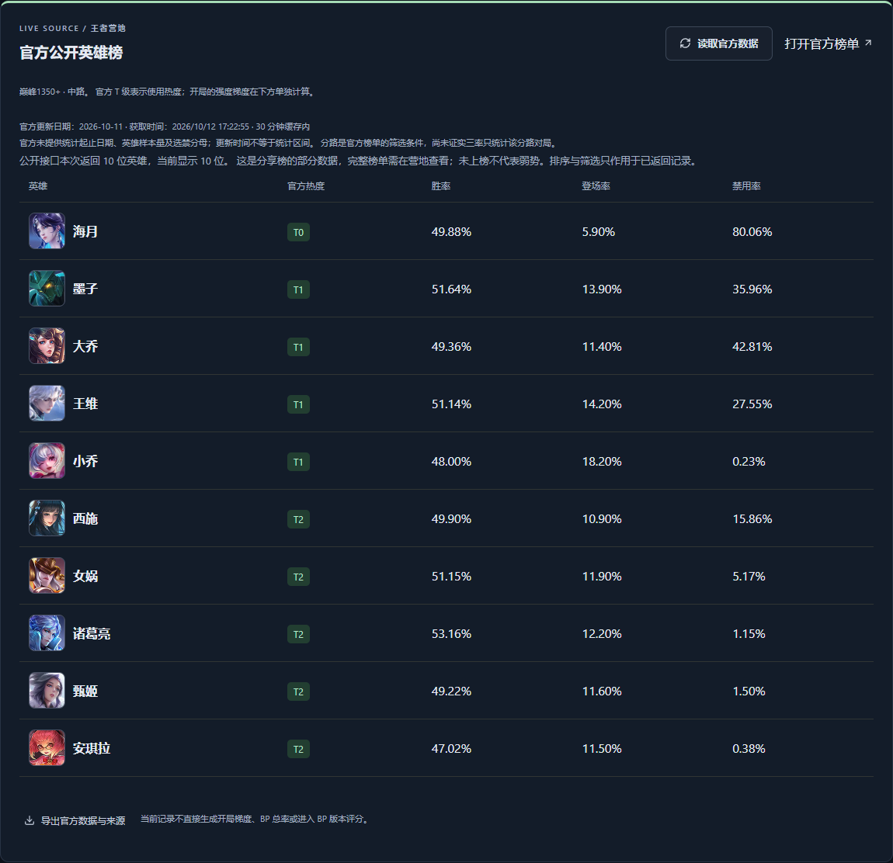

# 开局 NEXT · 你的王者备战台

面向王者荣耀玩家，把英雄资料、分段统计、个人英雄池、队友配合与有证据的复盘串起来。核心问题是：**这一局，我和队友真正适合拿什么，打完具体改什么？**

参赛者：蔡晨霖，西安交通大学人工智能 2501 班。**当前版本 v0.10.0，2026-10-13，本地可检查版本。** 新增双方教练博弈 BP、详细个人指标与打法档案、个性化英雄及训练卡、133 位英雄梯度总表、官方出装铭文和真实队友英雄池自适配体系。官方匿名公开榜继续提供三个分段、每分路十条统计。全英雄六分段完整统计、官方账号同步、完整录像理解及实际效果评测仍未完成，不能视为最终参赛成品。

v0.9 本轮新增：**本地截图识别建池**（核对后保存，详细表单折叠）、**分层头像梯度看板**、**115 件官方装备及三件对比**、**825 款清洗后的官方皮肤图录**、**20 条官方公告与每 15 分钟缓存更新**、**完整十手 BP 模拟训练场**。游戏账号同步、全量六分段/皮肤使用率/时长胜率及职业级 BP 仍未完成。

v0.10 新增：**公开榜单批量截图识别**、重复合并与冲突核对、**16 位天元之弈真实参考数据**（数据日 2026-10-11）、无需样本量即可查看的原始三率看板。来源切换同步作用于总表排序与详细表格。内置参考不写入玩家档案、不覆盖原有高精度数据。见 [本轮说明与边界](docs/17-public-table-capture.md)。



## 启动

环境：Node.js 24.16.0 或更新的 Node 24、npm。开发验收使用 Windows、Node 24.16.0、npm 11.13.0、Microsoft Edge。

```powershell
npm ci
npm run build
npm start
```

打开 http://127.0.0.1:4318 。Windows 可双击 `start-kaiju.cmd`。访客功能无需注册或模型密钥。首次安装需 npm 网络；英雄图片引用腾讯公开资源，部分引用可能失效，头像失败时显示文字。资料文本固定在仓库中，可离线查看。

开发：`npm run dev`，打开 http://127.0.0.1:4317 。服务仅监听本机。停止前台服务按 Ctrl+C。

## 五分钟检查

1. **玩家档案**：填写打法、偏好分路、操作接受度和训练目标；录入常用英雄的场次、评分、胜率、当前/历史战力与系数。胜场或胜率任选一种，未知字段留空，保存后进入英雄池与推荐。
2. **我的英雄池**：查看详细指标及准备度，比较适配英雄；打开英雄查看分阶段计划、英雄技能练习和针对薄弱点的训练卡。
3. **阵容备战**：在“教练博弈 BP”指定选手分工，选择两至五手深度并开始计算。检查对方回应与后续应对，只应用一手后再计算。空英雄池先补档案，或取消英雄池限制做练习。保留单位置推荐和逐轮 BP。
4. **体系练习**：查看孙白杨、乔离等 6 套模板；勾选共享好友后，按真实成员池推荐体系和自适配核心，显示具体分工及训练缺口。五人可生成完整起始阵容。
5. **录像复盘**：打开本地录像，播放到真实画面出现后暂停，截取决策点、标注已知条件，保存并重新打开。原视频保留在本机；截图和标注保存到当前账号。

补充检查：分段梯度的“全部英雄”默认列出 133 位，每位都可打开图鉴；缺失统计保持未知。切换大众分段、巅峰 1350+、顶端排位可读取官方公开分享榜，官方热度与开局梯度分开标明。详情包括技能冷却/消耗/提示、官方关系、攻略、出装、铭文与个人打法。导入统计支持批量截图识别、逐行填写、表格粘贴及 JSON。微信小程序口令可作来源，场次未公布就留空。“算法演示”明确为合成数据，不进入 BP。好友必须双方接受并主动共享后，才能使用其记录。

本轮详细说明：[v0.10 公开榜单批量识别](docs/17-public-table-capture.md)。上一版：[v0.9 截图、数据来源与 BP 验收](docs/15-screenshot-data-and-bp.md)。上一版：[v0.8 五项升级、算法与验收](docs/14-coach-and-personalization.md)。官方来源：[v0.7 官方公开数据核验](docs/13-official-public-data.md)。此前参考研究：[v0.6 实际观察、统计口径与历史对比](docs/12-tianyuan-observation-and-statistics.md)。

巅峰千强的“数据批次”现在可选择内置 **16 位英雄公开参考**，数据日 2026-10-11。之前本机访客工作台保存的 4 位英雄人工观察仍保留：在分段梯度选择“巅峰千强”，中路看海月，游走看鲁班大师、盾山、少司缘。可用 [观察快照 JSON](examples/tianyuan-observed-2026-10-11.json) 在其他账号导入；明确保留混合胜率口径、未知分母与缺失场次，不代表实时全榜，也不生成正式梯度。

历史逐项说明：[v0.5 参考访问、改进与补齐步骤](docs/11-reference-review-and-next-steps.md)、[v0.4 十项需求历史验收](docs/10-player-expansion-and-acceptance.md)。

## 功能与真实边界

| 模块 | 当前已实现 | 仍缺少的能力 |
| --- | --- | --- |
| 英雄资料 | 本次腾讯公开目录 133 位、技能文本、798 条定性关系、官网攻略、出装与铭文、个人训练卡 | 旧攻略可能滞后，无法解析的装备明确标注；没有逐英雄实战校准 |
| 分段梯度 | 三个官方公开分段自动读取三率与官方热度，30 分钟缓存和失败保留旧值；六分段手动快照、表格/粘贴/JSON 导入、口径校验和同口径历史对比 | 公开分享榜每分段分路仅返回 10 条；1800+、万强、千强未找到匿名官方入口；缺失样本和未知口径不进入自研梯度与 BP |
| 个性化 BP | 双方多步教练搜索、对手倾向、选手分工、准备度、可用统计、定性关系和阵容覆盖；独立线程、预算与过期结果处理；保留逐轮练习 | 最深五手，候选截断，权重未实战校准；不代表全局最优或职业水平；当前一手禁用后模拟选人，不覆盖所有禁用阶段 |
| 个人档案 | 详细战绩/评分/战力/系数、打法习惯、手动及文件导入/导出；直接影响推荐、BP、好友体系；有逐项解释 | 没有官方账号同步；战力去加成仅比较近似，不自动改写实际战力；自由文本未做语义分析 |
| 好友 | 独立账号、好友码、双向确认、可撤销共享、隔离存储、按好友英雄池备战 | 仅本机实例，尚未部署跨设备多人服务；不是游戏好友同步 |
| 体系 | 六套模板及三类自适配核心生成器；按实际不同成员池覆盖、准备度、最弱位置排序，列出分工和训练缺口；五人起始方案 | 不是实测胜率排行榜；不保证全局最优；尚无实时协作房间 |
| 刷野 | 红/蓝开顺刷模板；同英雄、路线、版本、条件的个人实测中位时间 | 无经过当前版本校准的逐英雄最优路线和官方出野秒数 |
| 复盘 | 真视频播放、截帧、时间线、条件标注、针对条件的建议、保存恢复和导出；可选视觉模型接口 | 未连接真实视觉模型、未评价真实对局分析质量；不支持整局自动理解 |

官方目录与资料获取于 2026-10-12；获取时间不是游戏版本更新时间。技能和机制以客户端为准。图片直接引用公开 URL，不打包腾讯图片。项目与腾讯、王者营地及天元之弈助手无隶属关系。

## 截图识别与资料更新

当前机器已安装本地 OCR。其他机器需先安装 Python，再运行 `npm run ocr:setup`，原图只在本机内存识别，用户核对后才保存字段，无模型 API 费用。真实游戏截图准确率尚需样本评测，合成样张端到端验证不代表所有游戏页面均准确。

`npm run resources:refresh` 刷新官方装备、皮肤与公告；服务运行期间每 15 分钟自动检查，失败保留旧数据并注明。`npm run bp:evaluate` 重跑固定种子对照模拟，不会训练或修改玩家记录及 BP 权重。

## 数据和模型

本地数据库 `data/kaiju.sqlite` 保存访客及各开局账号记录；未保存阵容按账号存入浏览器 localStorage。访客数据在注册后仍保留在访客工作台，不自动混入账号。测试数据库独立使用 `data/player-e2e`。旧方向的 `data/hengju.sqlite` 保留。迁移电脑前停止服务并备份完整 `data` 目录。

官方公开榜通过固定腾讯地址读取，服务端不发送游戏账号凭据。缓存保存在 `data/official-ranks`，不同分段分路独立保存；30 分钟内重复读取使用缓存，超过后在下次访问时更新。接口失败时明确提示旧记录，并保留原来源日期及获取时间；这不是全天后台定时同步。公开榜没有公布英雄样本量、版本或统计起止日期，官方热度不作为开局自研梯度，也不推算 BP 总率。

可选 AI：复制 `.env.example` 为 `.env`，填写兼容 chat/completions 的服务地址、密钥及模型名，再重启。备战解读发送当前英雄与阵容摘要；复盘需要支持图片的模型，仅用户点击分析时发送最多 6 张所选关键帧和标注。原始视频不上传。当前未配置真实模型；协议和错误恢复只用本机受控模拟验证。

统计导入不会核实来源页面是否真实发布过这些数值。v0.6 新增口径字段；旧批次未记录胜率人群/时间时保留原值并标为待核对，可导出补齐字段再作为新批次导入，不再默认参与梯度或 BP。用户仍须核对来源、时间、分母和版本。算法会剔除低样本的正式梯度、统一比较权重，并停用超过 14 天或日期异常的 BP 统计；这不替代版本更新核验。

## 验证与证据

v0.10 通过 **47 项核心/接口测试、30 项 Edge 浏览器测试**，构建和格式检查通过。真实天元之弈图片经过 OCR、逐项核对和独立测试数据库的完整导入流程；手机页面与运行中服务已检查，升级前后玩家数据指纹相同。见 [本轮验证结果](evidence/public-capture/validation.json)。

v0.9 最终通过 **43 项核心/接口测试、27 项 Edge 浏览器测试**，构建和格式检查通过。真实 OCR 使用明确标注的合成中文截图；官方数据用真实来源核验与固定公开夹具分别验证。结果、截图、12 场 BP 对照和来源记录见 [v0.9 验证摘要](evidence/data-upgrade/validation.json) 与 [详细说明](docs/15-screenshot-data-and-bp.md)。


```powershell
npm test
npm run build
npm run test:e2e
npm run format:check
```

v0.8 新增九项核心行为验证和四项浏览器流程，共 **37 项核心/接口测试、23 项 Edge 浏览器测试**；最终运行结果见 [v0.8 验收记录](evidence/coach-upgrade/validation.json)。新增测试核对手工穷举对抗结果、个人数据/习惯改变推荐、合法选序、计算预算、真实 Worker、详细档案持久化、完整目录联动及好友撤销共享。原有视频、统计口径、官方缓存和失败恢复、账号隔离、组队与手机测试继续保留。真实官方联网证据与模拟测试数据分开保存。

本轮运行中的真实页面检查见 [v0.8 本机检查](evidence/coach-upgrade/live-check.json)，新增图鉴、教练、个人池和体系截图位于同目录；测试账号截图明确在文档中注明。手机多列表格在卡片内横向滚动。旧版本证据保留，不混作本轮结果。完整技能与装备文本使资料脚本约 1.23 MB，构建提示超过 500 KB；尚未做详情按需加载。官网远程图片仍可能失效，文字与头像回退不依赖图片成功。

浏览器测试端口 4319；Windows 使用已安装的 Edge，其他系统先 `npx playwright install chromium`。视频测试夹具是仓库内自制的 3 秒合成 WebM，画面明确标注非游戏录像；运行测试不需 FFmpeg，重新生成时使用 `scripts/player/make-video-fixture.mjs` 和 `FFMPEG_PATH`。

- [本轮验收记录](evidence/reference-informed/validation.json)
- [v0.7 官方来源核验](evidence/official-public-data/source-verification.json)
- [v0.7 真实接口与页面检查](evidence/official-public-data/live-check.json)
- [v0.7 测试摘要](evidence/official-public-data/validation.json)
- [官方资料获取与逐条哈希](evidence/expansion/hero-fetch.json)
- [浏览器测试记录](evidence/reference-informed/browser-results.json)
- [本地运行与截图检查](evidence/reference-informed/live-check.json)
- [参考产品访问记录](evidence/reference-informed/reference-access.json)
- [真实迭代摘要](evidence/iterations/007-tianyuan-observed.md)

历史 v0.4 代码提交 `e76f322` 曾从全新 Git 归档和空数据库复现：**29.535 秒**完成源码展开、依赖安装、构建、16 项核心测试及启动检查。使用预装 Node/npm 与已有依赖缓存，不代表全新操作系统，也不包含浏览器套件。详见 [v0.4 复现记录](evidence/expansion/reproduction.json)；该时间不用于声明 v0.6 的全新环境复现结果。

刷新官方文本：`npm run data:refresh`。抓取校验英雄 ID 和名称，技能文本不完整时拒绝覆盖既有快照。日常运行不需刷新。

## 结构和参赛状态

- `src/player/`：基础玩家界面、目录、阵容规则；`pro/`：梯度、个人档案、好友、体系、刷野、录像复盘。
- `server/player/`：服务、SQLite、账号；`server/pro/`：新增模块接口与视觉适配器。
- `tests/player/`：真实浏览器流程；`server/player/*.test.ts`：核心与 HTTP 隔离测试。
- [原始赛题](docs/source/contest-requirements.original.txt)、[赛题拆解](docs/01-requirements.md)。旧“衡局”及旧版本材料保留为历史，不能混作当前验收结果。

距离最高奖项标准，仍需数据源和真实模型接入、真实玩家试用、战术校准、对比实验与演示用实际对局。正式 5–8 分钟 1080p 视频、≤30 页 PDF、三个完整原始 AI 对话链及远程评审仓库也未提交。迭代摘要不替代原始对话，工程测试通过不证明建议能提高实战胜率。
