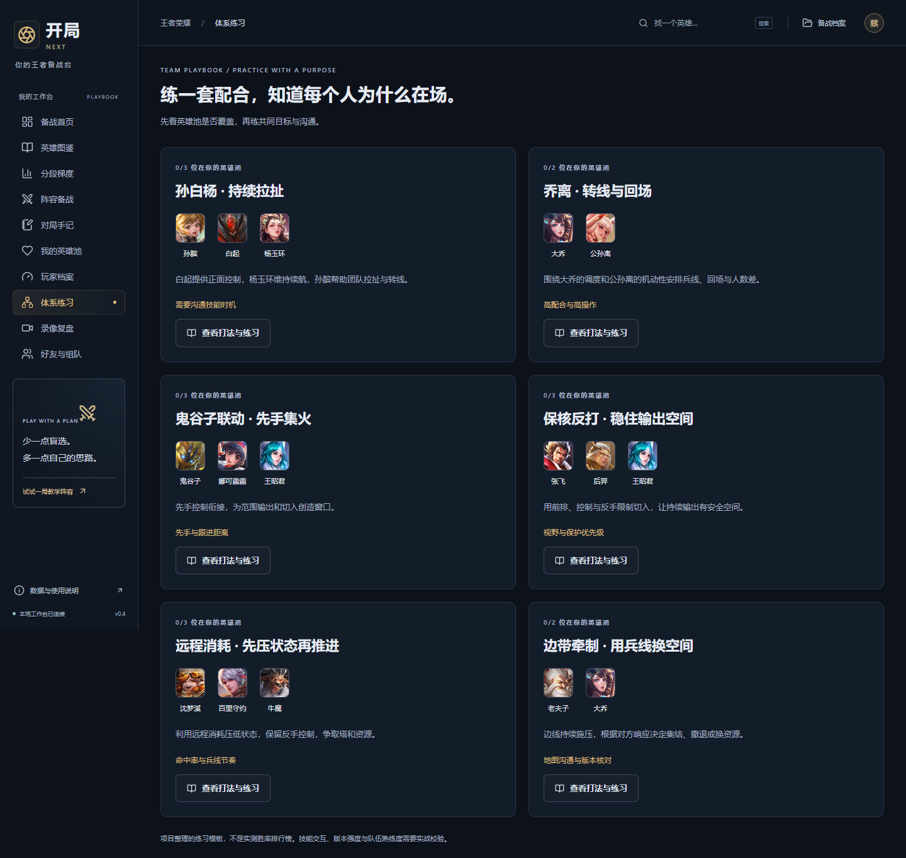

# 开局 NEXT · 你的王者备战台

面向王者荣耀玩家，把英雄资料、分段统计、个人英雄池、队友配合与有证据的复盘串起来。核心问题是：**这一局，我和队友真正适合拿什么，打完具体改什么？**

参赛者：蔡晨霖，西安交通大学人工智能 2501 班。**当前版本 v0.4.0，2026-10-12，本地可检查版本。** 已完成本轮工程扩展；真实分段数据自动接入、官方账号同步、完整录像理解及实际效果评测仍未完成，不能视为最终参赛成品。



## 启动

环境：Node.js 24.16.0 或更新的 Node 24、npm。开发验收使用 Windows、Node 24.16.0、npm 11.13.0、Microsoft Edge。

```powershell
npm ci
npm run build
npm start
```

打开 http://127.0.0.1:4318 。Windows 可双击 `start-kaiju.cmd`。访客功能无需注册或模型密钥。首次安装需 npm 网络；英雄图片引用腾讯公开资源，部分引用可能失效，头像失败时显示文字。资料文本固定在仓库中，可离线查看。

开发：`npm run dev`，打开 http://127.0.0.1:4317 。服务仅监听本机。停止前台服务按 Ctrl+C。

## 五分钟检查

1. **英雄图鉴**：搜索李白，查看技能、分段表现、官方搭配与克制、攻略及刷野模板。详情上方有章节快捷入口，关闭按钮固定可见。加入常玩的英雄并标记熟练度。
2. **玩家档案**：填入自己核对过的战力、巅峰分、近期场次与胜场，保存后用于个人准备度估计。记录越少，推荐越依赖明确的自报标签。
3. **阵容备战**：首页“体验一局示例”打开教学阵容。比较“更重熟练度 / 均衡 / 更重版本”，修改敌方、禁用或分路；可逐轮演练 BP，再保存或导出备战卡。
4. **体系练习**：查看孙白杨、乔离等 6 套练习模板，了解任务、风险和训练动作，带入阵容备战。
5. **录像复盘**：打开本地录像，播放到真实画面出现后暂停，截取决策点、标注已知条件，保存并重新打开。原视频保留在本机；截图和标注保存到当前账号。

补充检查：分段梯度可导入有出处的 JSON；“算法演示”始终标明合成数据，不能代表真实强度，也不会进入 BP。好友功能可在同一服务的两个浏览器会话中验证，双方接受并开启共享后，才能看英雄池或为好友选人。

详细逐项说明：[10 项需求与验收表](docs/10-player-expansion-and-acceptance.md)。

## 功能与真实边界

| 模块 | 当前已实现 | 仍缺少的能力 |
| --- | --- | --- |
| 英雄资料 | 本次腾讯公开目录 133 位，133 位完整解析的技能文本、798 条搭配/克制定性关系、官网攻略摘录 | 不能保证官网所有旧攻略符合当前客户端；尚无逐英雄实战校准 |
| 分段梯度 | 六种分段、分路、版本快照导入；可解释梯度分、原始胜率、出场/禁用/BP率、样本区间、出处 | 无六分段真实实时数据源；不会把合成演示充当榜单 |
| 个性化 BP | 全 133 位进入合法候选范围；个人准备度、可用分段统计、阵容能力和官方关系共同评分；逐轮禁选、撤回、保存 | 权重未用实战校准；训练 BP 轮次不等于全部游戏模式；尚无完整五人联合最优化 |
| 个人档案 | 手动录入、文件导入/导出、近期表现和数据日期；可配置战力系数推演 | 没有官方账号同步；系数默认值是假设参数，不自动改写实际战力 |
| 好友 | 独立账号、好友码、双向确认、可撤销共享、隔离存储、按好友英雄池备战 | 仅本机实例，尚未部署跨设备多人服务；不是游戏好友同步 |
| 体系 | 6 套项目练习模板，核心英雄、任务、风险、练习方法、英雄池覆盖 | 不等于经过胜率验证的当前版本最优体系 |
| 刷野 | 红/蓝开顺刷模板；同英雄、路线、版本、条件的个人实测中位时间 | 无经过当前版本校准的逐英雄最优路线和官方出野秒数 |
| 复盘 | 真视频播放、截帧、时间线、条件标注、针对条件的建议、保存恢复和导出；可选视觉模型接口 | 未连接真实视觉模型、未评价真实对局分析质量；不支持整局自动理解 |

官方目录与资料获取于 2026-10-12；获取时间不是游戏版本更新时间。技能和机制以客户端为准。图片直接引用公开 URL，不打包腾讯图片。项目与腾讯、王者营地及天元之弈助手无隶属关系。

## 数据和模型

本地数据库 `data/kaiju.sqlite` 保存访客及各开局账号记录；未保存阵容按账号存入浏览器 localStorage。访客数据在注册后仍保留在访客工作台，不自动混入账号。测试数据库独立使用 `data/player-e2e`。旧方向的 `data/hengju.sqlite` 保留。迁移电脑前停止服务并备份完整 `data` 目录。

可选 AI：复制 `.env.example` 为 `.env`，填写兼容 chat/completions 的服务地址、密钥及模型名，再重启。备战解读发送当前英雄与阵容摘要；复盘需要支持图片的模型，仅用户点击分析时发送最多 6 张所选关键帧和标注。原始视频不上传。当前未配置真实模型；协议和错误恢复只用本机受控模拟验证。

统计导入不会核实来源页面是否真实发布过这些数值。用户仍须核对来源、时间、分母和版本。算法会剔除低样本的正式梯度、统一比较权重，并停用超过 14 天或日期异常的 BP 统计；这不替代版本更新核验。

## 验证与证据

```powershell
npm test
npm run build
npm run test:e2e
npm run format:check
```

当前 **16 项核心/接口测试、13 项 Edge 浏览器测试通过**。浏览器测试覆盖导入统计与英雄页上下文、实际视频播放/截图像素/保存恢复、账号与好友授权、好友 BP、旧有备战及手记流程。8 种界面状态的 axe 自动检查无检出违规，每种仍有需人工判断的项目，不宣称完整 WCAG 认证。

桌面及 390px 手机的 10 个截图状态无页面横向溢出；无脚本错误。实测有 1 张官网旧路径封面返回 404，属于外部图片可用性问题。文字资料与核心操作可用。完整英雄文本使资料脚本约 692 KB，构建提示超过 500 KB；当前未做详情按需加载，仍是后续性能工作。

浏览器测试端口 4319；Windows 使用已安装的 Edge，其他系统先 `npx playwright install chromium`。视频测试夹具是仓库内自制的 3 秒合成 WebM，画面明确标注非游戏录像；运行测试不需 FFmpeg，重新生成时使用 `scripts/player/make-video-fixture.mjs` 和 `FFMPEG_PATH`。

- [本轮验收记录](evidence/expansion/validation.json)
- [官方资料获取与逐条哈希](evidence/expansion/hero-fetch.json)
- [浏览器测试记录](evidence/expansion/browser-results.json)
- [本地运行与截图检查](evidence/expansion/live-check.json)
- [真实迭代摘要](evidence/iterations/005-player-expansion.md)

当前代码提交 `e76f322` 已从全新 Git 归档和空数据库复现：**29.535 秒**完成源码展开、依赖安装、构建、16 项核心测试及本地服务启动检查。使用预装 Node/npm 与已有依赖缓存，不代表全新操作系统，也不包含浏览器套件。详见 [v0.4 复现记录](evidence/expansion/reproduction.json)。

刷新官方文本：`npm run data:refresh`。抓取校验英雄 ID 和名称，技能文本不完整时拒绝覆盖既有快照。日常运行不需刷新。

## 结构和参赛状态

- `src/player/`：基础玩家界面、目录、阵容规则；`pro/`：梯度、个人档案、好友、体系、刷野、录像复盘。
- `server/player/`：服务、SQLite、账号；`server/pro/`：新增模块接口与视觉适配器。
- `tests/player/`：真实浏览器流程；`server/player/*.test.ts`：核心与 HTTP 隔离测试。
- [原始赛题](docs/source/contest-requirements.original.txt)、[赛题拆解](docs/01-requirements.md)。旧“衡局”方向与 v0.3 的材料保留为历史，不能混作 v0.4 验收结果。

距离最高奖项标准，仍需数据源和真实模型接入、真实玩家试用、战术校准、对比实验与演示用实际对局。正式 5–8 分钟 1080p 视频、≤30 页 PDF、三个完整原始 AI 对话链及远程评审仓库也未提交。迭代摘要不替代原始对话，工程测试通过不证明建议能提高实战胜率。
