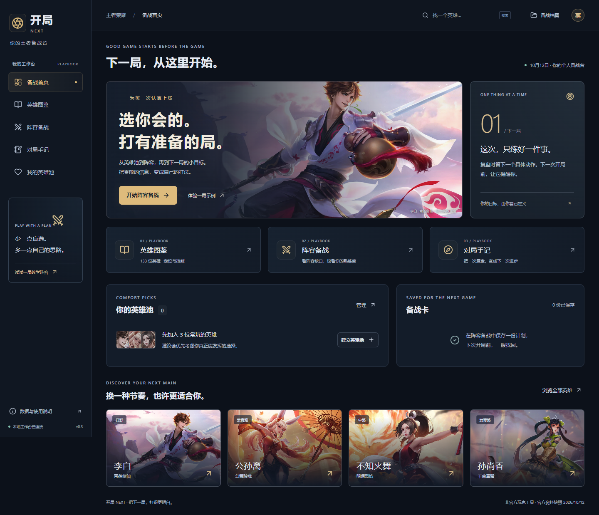

# 开局 NEXT · 你的王者备战台

开局 NEXT 面向王者荣耀玩家，把查英雄、选阵容和赛后练习串起来：先建立自己真正会玩的英雄池，再结合双方已选英雄比较候选，保存一份备战卡，打完后留下一项下一局能做到的改进。

参赛者：蔡晨霖，西安交通大学人工智能 2501 班。当前版本为 **v0.3 本地可检查版本，2026-10-12**。此前的“衡局”方向被用户否决，现已重做产品；旧代码在 Git 历史中，旧测试结果不能用于证明新版质量。



## 先打开，再检查

环境：Node.js 24.16.0 或更新的 Node 24、npm。开发与验收使用 Windows、Node 24.16.0、npm 11.13.0、Microsoft Edge。

```powershell
npm ci
npm run build
npm start
```

打开 **http://127.0.0.1:4318**。Windows 也可双击 **start-kaiju.cmd**。不需要注册、数据库安装或模型密钥。首次安装需要连接 npm 软件源，英雄图片需要连接腾讯公开图片域名；图片加载失败时会显示姓名缩略标识，资料和记录仍可使用。

开发模式：`npm run dev`，打开 http://127.0.0.1:4317。停止服务：启动终端按 Ctrl+C。端口被占用时，请关闭本项目此前的启动终端，或修改生产启动的 PORT；开发代理仍指向 4318。

## 五分钟体验路线

1. 首页点“体验一局示例”，进入真实英雄组成的教学阵容。教学阵容不是个人战绩。
2. 观察中路候选及“选前 / 选后”。切换候选，对照推荐理由、取舍和练习目标。删除或更换对方英雄后，相关判断会重新计算。
3. 在“英雄图鉴”搜索王昭君、小乔或你常玩的英雄，查看官方技能快照，加入英雄池，设为“本命”或“熟练”。返回备战页，勾选“只从我的英雄池里选”。
4. 保存备战卡、导出 Markdown 卡片，再从右上角“备战档案”打开。可修改双方全部位置和禁用英雄；同一英雄不能重复出现。
5. “对局手记”记录一局你实际打过的对局，写下一项具体的下局行动。首页会提醒最新未完成目标；手记可编辑、标记完成，修改目标后完成状态会重置。

详细说明见 [第一次检查指南](docs/09-player-review-guide.md)。

## 已实现与实际边界

| 功能 | 当前行为与边界 |
| --- | --- |
| 英雄资料 | 官方公开目录 133 位；117 位有已解析的官方技能页，16 个旧页返回 404，不补造技能。名称、定位、分路和来源链接均可查看。 |
| 个人英雄池 | 自己选择英雄及熟练度，本机保存，刷新可恢复。 |
| 阵容备战 | 双方 10 个位置、最多 10 个禁用位；根据分路、阵容能力缺口和熟练度给出最多 3 个候选。 |
| 推荐依据 | 40 位英雄的项目战术笔记参与排序。定性规则，未经实战数据校准；不提供预测胜率、全服排行或装备数值模拟。 |
| 备战卡 | 保存、重新打开和导出；重新打开按当前英雄池计算，保留仍可用的已选候选。 |
| 对局手记 | 手动录入胜负、KDA、时长、复盘和下局目标。样本胜率仅来自已录入手记，没有读取游戏账号。 |
| AI 解读 | 可选模型接口已实现，当前未配置真实模型。使用本机模拟服务验证了协议和异常处理，尚未验证真实生成质量。 |

英雄目录获取于 2026-10-12。官网未提供统一版本号，**获取时间不等于游戏版本更新时间**。技能以游戏客户端为准。图片直接引用官方公开资源，未打包下载；版权归相应权利人。开局 NEXT 是独立参赛项目，无官方隶属关系。

## 本机数据与配置

数据文件：`data/kaiju.sqlite`。英雄池、阵容、备战卡及对局手记保存在此。浏览器的未保存阵容另存于当前站点的 localStorage。测试使用 `data/player-e2e`，不写入个人数据库。旧版 `data/hengju.sqlite` 保留，两者相互独立。

当前为单人本地服务，只监听 127.0.0.1；不包含公网多用户账号体系。更换电脑时，先停止服务，再备份完整的 data 目录。工作台读取最近 200 条手记及最近 50 份卡片；旧数据仍在库内。

可选 AI：复制 `.env.example` 为 `.env`，填写 MODEL_BASE_URL、MODEL_API_KEY、MODEL_NAME，再重启服务。点击“AI 展开解读”时才发送当前英雄资料、阵容和笔记摘要到所配置服务，可能产生费用。密钥保留在服务端，不进入 Git。建议和记录功能不依赖 AI 配置。

## 验证与复现

```powershell
npm test
npm run build
npm run test:e2e
npm run format:check
```

本轮 **7 项核心/接口测试和 7 项 Edge 浏览器测试通过**。无障碍自动检查覆盖桌面首页、桌面备战页、手机英雄详情，无自动检出的违规，仍有需要人工判断的项目，不等于完整 WCAG 认证。

浏览器测试服务使用 4319 端口；Windows 调用已安装的 Edge，其他系统需先 `npx playwright install chromium`。测试包含正常模型响应、无效响应、服务失败恢复和过期响应丢弃，均使用受控模拟，不冒充真实模型调用。

刷新公开英雄快照：`npm run data:refresh`。这会联网重新获取目录与技能页，并更新数据及失败清单。目录快照固定在仓库中，正常运行不需要重新抓取。

证据入口：[新版验收记录](evidence/player/validation.json)、[资料获取记录](evidence/player/data-fetch.json)、[无障碍检查](evidence/player/accessibility.json)、[本轮实际迭代](evidence/iterations/004-player-rebuild.md)。提交 5d5be5a 的新目录实际复现为 **33.207 秒**，含归档、安装、构建、核心测试和启动检查；使用预装 Node/npm 及已有缓存。后续手机布局修改已通过构建和完整浏览器复验。详见 [复现记录](evidence/player/reproduction.json)，不沿用旧方向计时。

## 结构与参赛进度

- `src/player/`：玩家界面、英雄快照、输入模型、推荐规则。
- `server/player/`：HTTP 接口、SQLite 持久化、可选模型配置。
- `tests/player/`：浏览器用户流程与无障碍检查。
- [产品重做与技术说明](docs/08-player-rebuild.md)：定位、研究依据、排序方式和限制。
- [原始赛题](docs/source/contest-requirements.original.txt)：保留用户所给材料。
- [赛题拆解](docs/01-requirements.md)：赛事时间存在矛盾，报名与实际截止时间需以官方个人中心为准。

本地产品可以检查；冲击奖项还需要真实玩家试用和战术笔记校准、确认差异价值、补齐三个完整原始 AI 对话链、5–8 分钟 1080p 视频（至少 2 分钟协作过程）、不超过 30 页 PDF 和可供评审访问的远程仓库。整理的迭代摘要不能替代原始对话证据，也不能承诺获奖。docs/04–07 和 evidence/checks 是旧方向的历史材料，应结合版本阅读。
